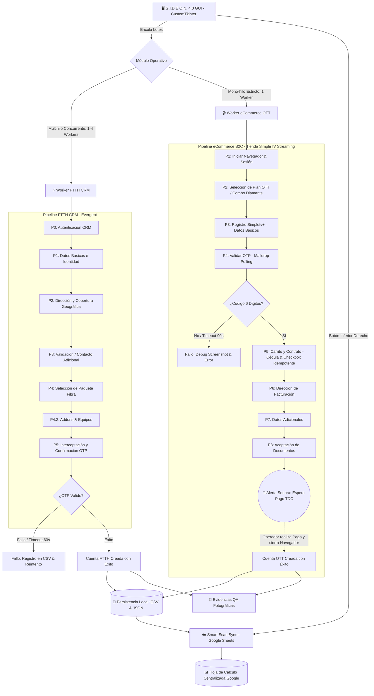
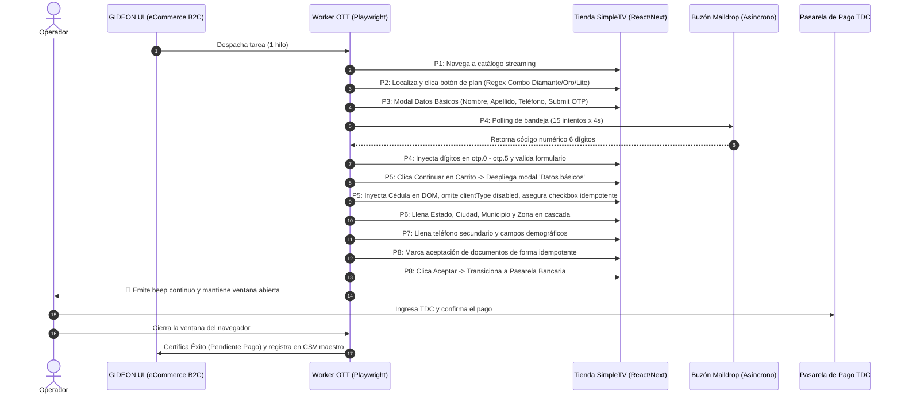
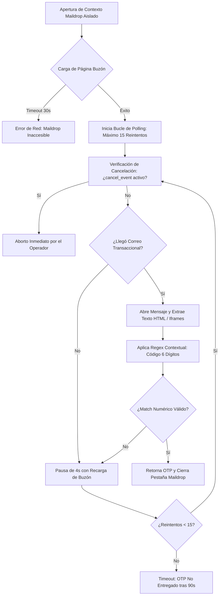
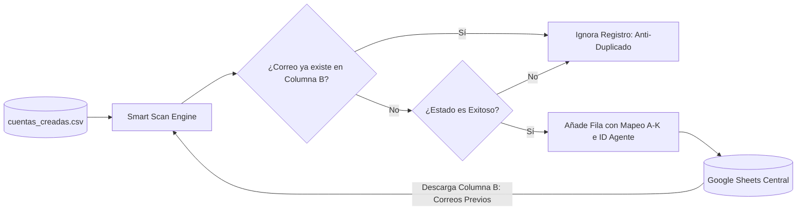

# 🏗️ Arquitectura de Flujos de G.I.D.E.O.N. 4.0 Oficial

El sistema orquesta el aprovisionamiento automatizado mediante procesos independientes ejecutados en instancias aisladas de Chromium gestionadas por **Playwright** (`sync_playwright`). El núcleo operativo soporta tres pipelines: **FTTH CRM (Evergent)**, **eCommerce B2C (OTT Streaming)** y **Sincronización Cloud (Google Sheets)**.

---

## 1. Diagrama Macro de Arquitectura y Orquestación

---

## 2. Detalle Exhaustivo del Pipeline OTT (Streaming B2C: P1 a P8)

A diferencia de los flujos de prueba simplificados, el worker en producción de OTT ([`automation/worker_ott.py`](file:///c:/Users/KGarcia.Pasante/Music/GIDEON%203.1/GIDEON/automation/worker_ott.py)) ejecuta **8 pasos rigurosos y cronometrados**:

---

## 3. Detalle del Ciclo de Interceptación OTP (Maildrop Engine)

La validación por OTP en [`automation/crm_helpers.py`](file:///c:/Users/KGarcia.Pasante/Music/GIDEON%203.1/GIDEON/automation/crm_helpers.py) y [`automation/worker_ott.py`](file:///c:/Users/KGarcia.Pasante/Music/GIDEON%203.1/GIDEON/automation/worker_ott.py) opera con un bucle de tolerancia asíncrona:

---

## 4. Arquitectura de Sincronización Cloud (Smart Scan Google Sheets)

Para evitar duplicaciones y colisiones al sincronizar desde múltiples computadoras de operadores hacia una misma hoja de cálculo:

---

## 5. Decisiones Técnicas y Justificación de Arquitectura

1. **Aislamiento Multihilo de la GUI:** Todo proceso de Playwright se ejecuta dentro de un hilo secundario (`threading.Thread` o `ThreadPoolExecutor`). La interfaz de CustomTkinter **únicamente** recibe eventos a través de `self.after(0, callback)` para evitar el congelamiento de la ventana principal.
2. **Desacoplamiento de Monitores de Progreso:** A partir de la versión 4.0, FTTH CRM y eCommerce OTT poseen paneles gráficos y estructuras de datos de cronómetro completamente independientes (`frame_monitor_hilos` vs `frame_monitor_hilos_ott`).
3. **Idempotencia en Checkboxes:** Todos los checkboxes en formularios React se validan con la función [`asegurar_checkbox`](file:///c:/Users/KGarcia.Pasante/Music/GIDEON%203.1/GIDEON/automation/worker_ott.py), la cual evalúa `is_checked()` antes de interactuar, erradicando el error de "doble toggle" que desmarcaba la declaración de datos.
4. **Resiliencia ante Elementos Deshabilitados:** Los selectores con atributo `disabled` (como el tipo de cliente predeterminado en la tienda online) son detectados preventivamente con `is_enabled()`, omitiendo los timeouts de 45 segundos de Playwright.
