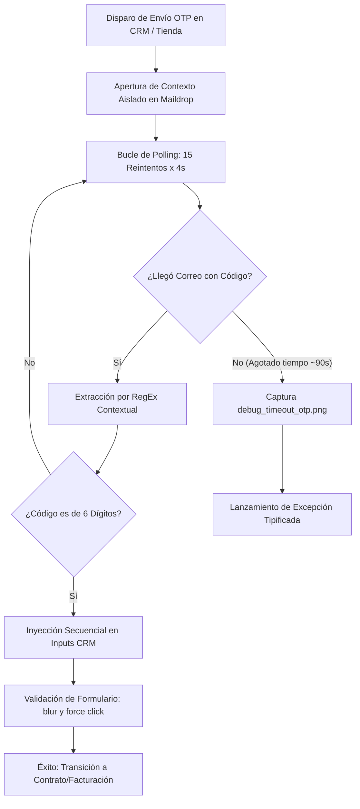

# 🛡️ Protocolo de Auditoría, Seguridad y Trazabilidad QA - G.I.D.E.O.N. 4.0

Este documento establece las políticas operativas, medidas de seguridad de la información y procedimientos de trazabilidad para el aprovisionamiento automatizado (RPA) de cuentas mediante **G.I.D.E.O.N. 4.0**. Sirve como guía de conformidad ante auditorías técnicas, revisiones de seguridad informática y control de calidad corporativo.

---

## 1. Seguridad de la Información y Gestión de Credenciales

### 1.1. Cero Secretos Hardcodeados
- **Directriz Estricta:** Queda terminantemente prohibido incluir contraseñas, tokens de autenticación o claves de API directamente en el código de Playwright o en la interfaz gráfica.
- **Inyección Controlada:** Toda autenticación hacia el CRM Evergent o endpoints auxiliares se alimenta dinámicamente desde `config_gideon.json` o variables de entorno del sistema operativo.
- **Sanitización de Git:** El archivo `.gitignore` prohíbe explícitamente el seguimiento de credenciales temporales, archivos de entorno (`.env`, `.venv`), tokens y logs con información operativa.

### 1.2. Protección de Datos Personales (PII) y Generadores Sintéticos
- **Cumplimiento de Privacidad:** En entornos de prueba y certificación (QA / Staging), no se utilizan datos de clientes reales.
- **Generación Sintética Determinística (`core/generadores.py`):**
  - **Cédulas y RIFs:** Se calculan respetando la longitud y estructura de validación venezolana (prefijos `V`, `E`, `J`, `G`).
  - **Identidades:** Generación aleatoria mediante catálogos de nombres y apellidos homologados sin vinculación a personas naturales vivas.
  - **Teléfonos:** Prefijos móviles nacionales oficiales (`0412`, `0414`, `0424`, `0416`, `0426`) con asignación sintética de los 7 dígitos restantes.

### 1.3. Aislamiento de Estados de Sesión (`auth_state.json`)
- Las cookies de sesión y tokens JWT generados por Chromium para acelerar el ingreso al CRM Evergent son volátiles.
- Antes de cualquier commit o pase a producción, se audita que `auth_state.json` no contenga sesiones activas ni credenciales corporativas comprometidas.

---

## 2. Protocolo de Evidencias Fotográficas y Auditoría Forense

Cada cuenta procesada debe contar con respaldo visual indeleble que certifique el estado exacto en que concluyó la transacción:

```text
GIDEON/
├── Evidencias_QA_Fibra/            # Capturas de cuentas exitosas de FTTH (Evergent)
│   └── YYYY-MM-DD/
│       └── Hilo1_CAMtestO_Fibra..._P5_Exito.png
├── Evidencias_QA_OTT/              # Capturas paso a paso (P1 a P8) de streaming OTT
│   └── YYYY-MM-DD/
│       └── CAMBIALOT_OTT.../
│           ├── Hilo1_P1_Iniciar_Navegador.png
│           ├── Hilo1_P2_Selección_de_Plan_OTT.png
│           ├── Hilo1_P3_Registro_Simpletv+.png
│           ├── Hilo1_P4_Validar_OTP.png
│           ├── Hilo1_P5_Carrito_y_Contrato.png
│           ├── Hilo1_P6_Dirección_de_Facturación.png
│           ├── Hilo1_P7_Datos_Adicionales.png
│           └── Hilo1_P8_Aceptación_de_documentos.png
└── logs/screenshots/               # Capturas de tracebacks y errores no controlados
    └── ERROR_hilo1_Paso_..._YYYYMMDD_HHMMSS.png
```

### Reglas de Nomenclatura y Almacenamiento:
1. **Identificador Único:** Cada captura vincula obligatoriamente el ID del hilo de ejecución y el correo electrónico único asignado.
2. **Punto de Control:** En OTT, se captura evidencia en cada transición de paso (P1 a P8). Si la cuenta falla, la última captura certifica visualmente la causa del colapso (por ejemplo, validación roja en el formulario o modal no desplegado).
3. **Exclusión en Git:** Ningún archivo de imagen (`.png`, `.jpg`) de las carpetas de evidencias se commitea en el repositorio de control de versiones para evitar la saturación del árbol Git y la fuga de datos.

---

## 3. Protocolo Crítico para Manejo y Validación de OTP

La validación por código OTP (One-Time Password) representa el punto de sincronización asíncrono más sensible del flujo:



### Reglas Técnicas de Mitigación de Fallas:
- **Formato Rígido:** El código debe cumplir estrictamente con `^\d{6}$`.
- **Estrategia Multi-Caja:** En interfaces React con cajas separadas (`otp.0` a `otp.5`), cada dígito se escribe con ligera pausa y se fuerza el evento `blur()` en la última casilla para activar la reactividad del formulario.
- **Captura Forense Automática:** Si el código no llega dentro del umbral o expira el tiempo límite, el bot toma automáticamente una captura de depuración (`debug_<id_hilo>_timeout_otp.png`) antes de declarar el fallo.

---

## 4. Gestión de Concurrencia y Prevención de Bloqueos (Rate Limiting)

| Módulo | Política de Concurrencia | Justificación Técnica de Auditoría |
|---|---|---|
| **FTTH CRM (Evergent)** | **Multihilo Paralelo** (1 a 4 hilos) | El backend de Evergent soporta sesiones concurrentes independientes autenticadas con `sessionId` aislado por contexto de Playwright. |
| **eCommerce OTT (Tienda B2C)** | **Mono-hilo Estricto** (1 hilo a la vez) | La tienda online implementa defensas anti-spam en el envío de OTP hacia un mismo dominio de correo y requiere supervisión humana en la pasarela de pago. |

---

## 5. Procedimiento de Recuperación ante Incidentes (Runbook)

En caso de fallo en una tanda de aprovisionamiento:
1. **Reintento de Cuentas Fallidas:** El operador presiona **`🔁 Reintentar (X)`** en FTTH o **`Reenviar a la Cola`** en el Historial para retomar exclusivamente los registros con error.
2. **Auditoría del Error:** El operador y TI pueden revisar `cuentas_creadas.csv` donde el campo `Estado` describe exactamente el selector que falló o el timeout experimentado.
3. **Parada de Emergencia:** Al presionar **`🛑 Cancelar`**, todos los workers activos verifican el `cancel_event`, cierran ordenadamente sus contextos de Chromium y liberan la memoria RAM sin dejar procesos huérfanos.
